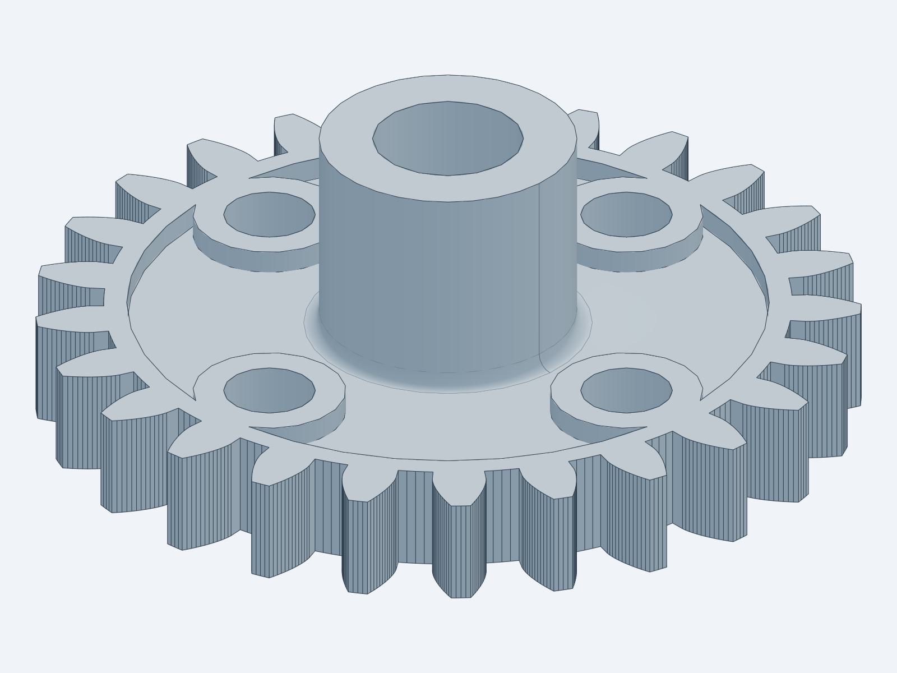
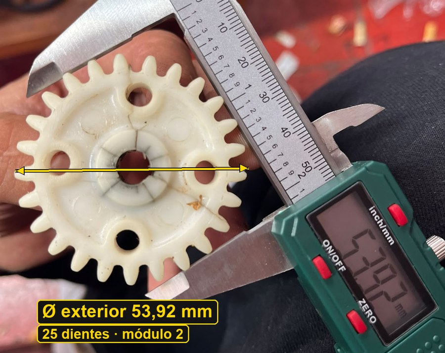
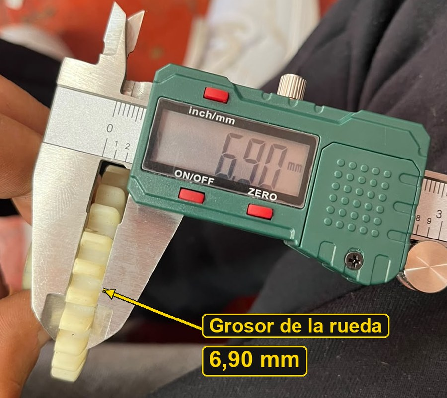
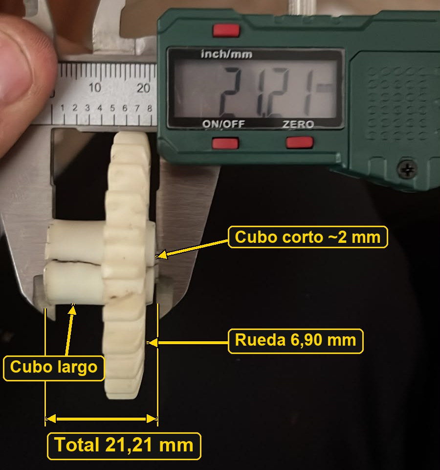
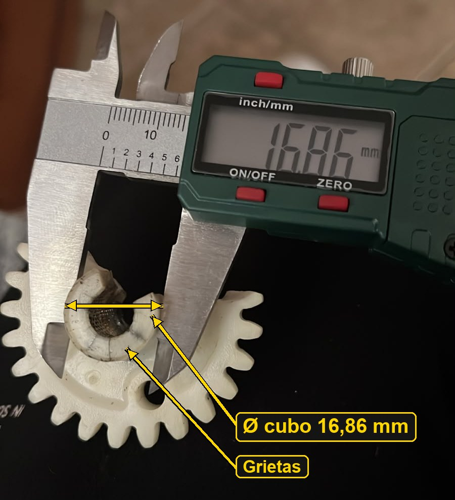
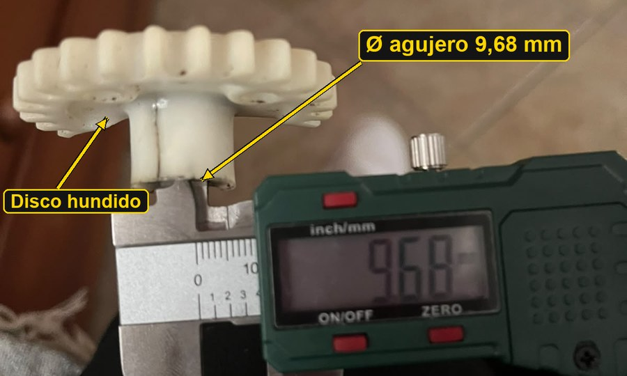
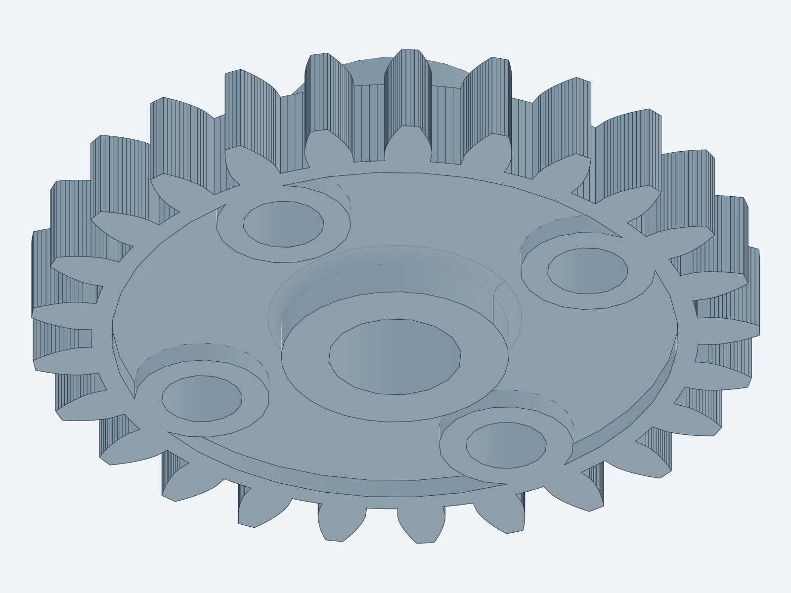

# De un engranaje roto a uno impreso en 3D

Este engranaje de plástico tiene el cubo central agrietado. En lugar de buscar
el recambio, decidí medirlo, modelarlo en CAD e imprimirlo. Este es el proceso,
con las medidas, las dudas que fueron surgiendo y cómo se resolvieron.



---

## 1. Medir la pieza original

Con un calibre digital tomé las medidas básicas. Cada foto es una cota del
modelo.

### Diámetro exterior: 53,92 mm



Esta es la medida más importante, porque de ella sale el tamaño del diente. En
un engranaje recto el diámetro exterior es `módulo × (dientes + 2)`. Con
**25 dientes** sale un **módulo 2** casi exacto: el teórico es 54 mm y medí
53,92 mm, lo que encaja con el desgaste del plástico. Módulo 2 es un valor
estándar, así que todo cuadra.

### Grosor de la rueda dentada: 6,90 mm



### Longitud total con el cubo: 21,21 mm



Aquí se ve algo que en la primera versión del modelo se me pasó: **el cubo
sale por los dos lados**. Por un lado sobresale unos 12 mm y por el otro un
tramo corto de unos 2 mm.

### Diámetro del cubo: 16,86 mm



En esta foto se ven las grietas del cubo, que son el motivo de hacer el
recambio.

### Agujero central: 9,68 mm



---

## 2. Lo que no salía en las fotos

Hubo detalles que no estaban medidos:

| Detalle | Valor usado | Origen |
|---|---|---|
| Número de dientes | 25 | Deducido del diámetro (módulo 2) |
| 4 agujeros pasantes | Ø6 mm sobre un círculo de Ø33 mm | Estimado en la foto |
| Anillos alrededor de los agujeros | Ø10 mm | Estimado en la foto |
| Cubo en el lado corto | 2 mm | Estimado en la foto |
| Hundimiento del disco | 1,5 mm por cada cara, dentro de Ø42 mm | Estimado en la foto |

## 3. Primera versión... y el hundimiento

La primera versión era un disco plano con dientes y un cubo por un solo lado.
Al abrirla en Bambu Studio la vi rara comparada con la pieza real. Al revisar
las fotos con más atención apareció lo que faltaba:

- **El disco no es plano.** La corona dentada y los anillos de los 4 agujeros
  tienen el grosor completo (6,90 mm), pero entre ellos el disco está
  **hundido**. Este rebaje ahorra material y es típico de las piezas
  inyectadas.
- **El cubo sale por los dos lados**, no solo por uno.

La segunda versión ya incluye las dos cosas:



## 4. El modelo

Lo modelé en Python, en [`engranaje.py`](engranaje.py), con
[build123d](https://github.com/gumyr/build123d) y
[text-to-cad](https://github.com/earthtojake/text-to-cad). Los dientes tienen
**perfil de evolvente** real (no son trapecios), con una pequeña holgura para
que engranen sin agarrotarse.

| Parámetro | Valor |
|---|---|
| Módulo / dientes | 2 / 25 |
| Ángulo de presión | 20° |
| Diámetro exterior | 54 mm |
| Grosor de la rueda | 6,90 mm |
| Longitud total | 21,21 mm (cubo largo 12,31 + rueda 6,90 + cubo corto 2,00) |
| Diámetro del cubo | 16,86 mm |
| Agujero central | 9,88 mm (9,68 + 0,2 de holgura de impresión) |
| Grosor del disco hundido | 3,9 mm |
| Holgura entre dientes | 0,15 mm |

Todas las medidas son variables al principio del script. Si al montarlo algo
no encaja, se cambia el número y se vuelve a generar:

```bash
python engranaje.py
```

Eso genera de nuevo los tres archivos:

- `STEP/engranaje.step`: modelo CAD, para editarlo en otro programa
- `STL/engranaje.stl`: malla para cualquier laminador
- `3MF/engranaje.3mf`: proyecto de Bambu Studio

## 5. Imprimirlo

- **Orientación:** el cubo corto apoyado en la cama y el largo hacia arriba.
- **Soportes:** de tipo árbol y solo desde la cama, porque la corona dentada
  queda 2 mm en el aire.
- **Material:** PETG, ASA o nylon mejor que PLA, porque aguantan más el roce y
  el calor.
- **Ajustes:** 4 perímetros o más y un relleno del 40 % o superior.

## Herramientas

- **Medición:** calibre digital.
- **Modelado:** Python con build123d y text-to-cad.
- **Laminado:** Bambu Studio.
- **IA:** me ayudé de una IA para redactar este texto, editar las fotos (recorte,
  cotas y flechas) y revisar el modelo.
